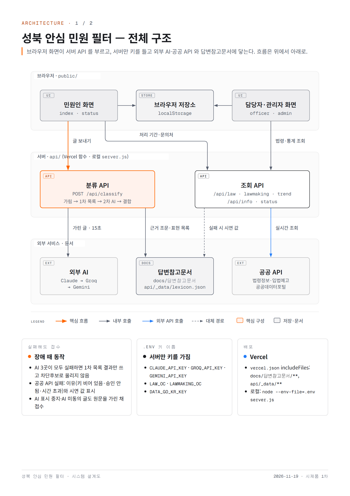
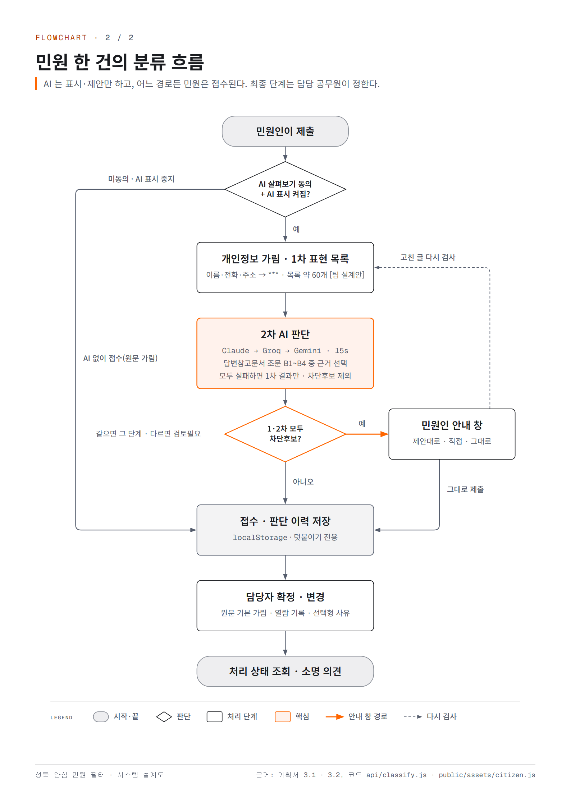

# 성북 안심 민원 필터

AI가 온라인 글 민원의 욕설·위협 표현을 **표시하고 제안만 하며, 최종 결정은 담당 공무원이 하는** 서비스 시제품입니다.
한성대학교 「AI 기반 공공행정」 캡스톤 과제(2026-2학기)로, 성북구 「구청장에게 바란다」 같은 글 민원 게시판을 가정해 만들었습니다.

> 시제품입니다. 가상 민원과 공개 자료만 쓰며, 실제 민원이나 개인정보를 넣지 마세요.

## 이 서비스가 하는 일

| 하는 것 | 하지 않는 것 |
|---|---|
| 글에서 욕설·모욕·협박·성희롱 표현을 찾아 **정상 / 검토필요 / 차단후보** 세 단계로 표시 | 접수 거부, 삭제, 자동 종료 |
| 담당 공무원에게 원문 대신 **순화본과 핵심 요약**을 먼저 보여 주고, 원문은 [원문 보기]로만 열람(열람 기록 남김) | 특정 민원인 추적·제재 |
| 민원인에게 고쳐 쓸 문장을 제안(제안대로 / 직접 고치기 / **그대로 제출** 중 선택) | AI의 최종 판정 |

- 안내 창은 1차 표현 목록과 2차 AI가 **모두** 차단후보로 볼 때만 뜹니다. 어느 선택이든 민원은 접수됩니다.
- AI 판단 근거는 `docs/답변참고문서`의 조문 원문(성북구 조례, 「민원 처리에 관한 법률」 등)에서만 고르고, 문서에 없는 근거는 서버가 버립니다.

## 화면

| 화면 | 주소 | 쓰는 사람 | 내용 |
|---|---|---|---|
| 민원 쓰기 | `/` | 민원인 | 글 작성, 개인정보 수집 안내·동의, 안내 창 |
| 담당자 현황판 | `/officer` | 담당 공무원 | 단계별 목록, 요약·순화본, 판단 근거, 관련 규정, 단계 확정·변경 |
| 관리·감독 | `/admin` | 관리자·감사 | 지표, 오분류 사례, 판단 이력, AI 표시 중지, 연결 상태 |

## 시스템 설계도

### 1. 전체 구조

브라우저 화면이 서버 API를 부르고, 키는 서버만 가지고 외부 AI·공공 API·답변참고문서에 닿습니다. 흐름은 위에서 아래로 그렸습니다.



### 2. 민원 한 건의 분류 흐름



PDF 원본: [docs/시스템설계도.pdf](docs/시스템설계도.pdf) · HTML 원본: [docs/시스템설계도.html](docs/시스템설계도.html)

## AI 호출 순서

`CLAUDE_API_KEY` → `GROQ_API_KEY` → `GEMINI_API_KEY` 순서로 부르고, 앞이 실패하면(키 없음·오류·시간 초과 15초) 다음으로 넘어갑니다.
모델 이름은 코드에 적지 않고 키로 모델 목록을 조회해 정합니다. 셋 다 실패하면 1차 표현 목록 결과만 쓰며, 이때는 차단후보로 올리지 않고 원문을 가린 채 접수합니다.

## 공공 API

| 용도 | 키 이름 | 실패할 때 |
|---|---|---|
| 현행 법령·조례, 변경이력, 신구법 비교 | `LAW_OC` | 이유(키 비어 있음·승인 안 됨·시간 초과)와 「시연 값」 표시 |
| 진행 중인 입법예고 | `LAWMAKING_OC` | 같음 |
| 민원 키워드 동향(권익위 민원빅데이터) | `DATA_GO_KR_KEY` | 같음 |

## 실행

Node.js 20 이상이 필요합니다.

```bash
npm install
npm run dev        # = node --env-file=.env server.js  →  http://localhost:3000
```

`.env`가 없어도 `node server.js`로 띄울 수 있으며, 이때 AI·공공 API는 「시연 값」으로 응답합니다.

`.env`에는 아래 이름으로 키를 적습니다(저장소에는 올리지 않습니다).

```
CLAUDE_API_KEY=
GROQ_API_KEY=
GEMINI_API_KEY=
LAW_OC=
LAWMAKING_OC=
DATA_GO_KR_KEY=
```

## 폴더 구성

```
public/            이용자가 보는 화면(index·status·officer·admin, assets/)
api/               서버 코드(classify·law·lawmaking·trend·info·status, _lib/, _data/)
docs/답변참고문서/   AI가 근거로 쓰는 법령·조례·안내 문서
docs/images/       README용 설계도 이미지
server.js          로컬 실행(public + /api)
vercel.json        배포 설정(includeFiles: docs/답변참고문서, api/_data)
```

배포는 [Vercel](https://vercel.com)을 쓰며, 절차는 [docs/배포가이드.md](docs/배포가이드.md)를 따릅니다.

## 시제품의 한계

- 민원과 판단 이력은 브라우저 저장소(`localStorage`)에만 저장됩니다. 실제 도입 때는 서버 저장소와 로그인·권한 구분이 필요합니다.
- 1차 표현 목록은 시제품용 소형 목록(약 60개)입니다.
- 외부 AI 전송이 개인정보 처리 위탁·국외 이전에 해당하는지, 보유 기간 등은 확인이 필요합니다.
